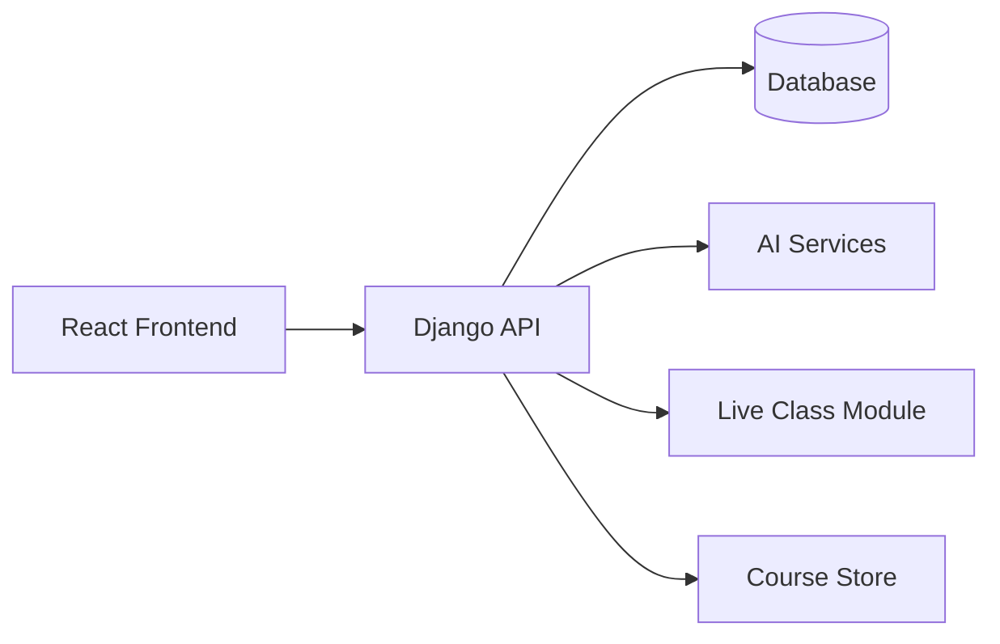

# Edrok: پلتفرم آموزش آنلاین (Case Study)

> **پروژه‌ی خصوصی برای کارفرما.** کد منبعش عمومی نیست؛ این صفحه فقط توضیح می‌دهد پروژه چیست، من چه کاری توش کردم و چرا بعضی تصمیم‌های فنی را این‌طوری گرفتم.

## معرفی

Edrok یک پلتفرم آموزشی Full-Stack است که برای یک کارفرمای بریتانیایی ساختم. ایده این بود که کلاس زنده، فروش دوره و ابزارهای هوشمند آموزشی همه توی یک پلتفرم کنار هم باشند و آموزش، پشتیبانی و ارزیابی از یک جا مدیریت شود، نه از پنج جای مختلف.

## نقش من

توسعه‌دهنده‌ی Full-Stack. بک‌اند (Django) و فرانت‌اند (React) را نوشتم و قابلیت‌های هوش مصنوعی را هم خودم به پلتفرم اضافه کردم.

## قابلیت‌های اصلی

* **کلاس زنده:** یک ماژول کلاس مجازی، در سبک BigBlueButton و Skyroom
* **پشتیبانی هوشمند:** سؤال‌های دانشجوها را هوش مصنوعی خودکار جواب می‌دهد
* **تصحیح هوشمند تمرین:** روی تمرین‌هایی که دانشجوها می‌فرستند خودکار بازخورد می‌دهد
* **آزمون و کوییز هوشمند:** سؤال‌ها را خودش می‌سازد و ارزیابی می‌کند
* **فروشگاه دوره:** هم دوره‌ی آنلاین می‌فروشد، هم آفلاین
* **حساب کاربری و دسترسی:** کاربرها سطح دسترسی دارند (Role-Based)

## معماری

## تکنولوژی‌ها

* **بک‌اند:** Python، Django
* **فرانت‌اند:** React
* **هوش مصنوعی:** پشتیبانی، تصحیح و ساخت آزمون با LLM
* **Real-time:** اتصال کلاس زنده به پلتفرم

## چالش‌های فنی

* **جا دادن چند محصول توی یک پلتفرم.** کلاس زنده، فروشگاه و ابزارهای هوشمند هرکدام نیازهای خودشان را دارند. برای همین هرکدام را یک ماژول جدا کردم و همه را پشت یک API مشترک گذاشتم.
* **قابل‌اعتماد کردن خروجی AI.** برای تصحیح تمرین و ساخت آزمون نمی‌شود به متن آزاد اکتفا کرد؛ خروجی باید ساختاریافته و ثابت باشد.
* **پشتیبانی از خریدارهای دوره‌ی آنلاین و آفلاین** با یک کاتالوگ و یک مسیر خرید.

## ملاحظات امنیتی

چون پلتفرم با داده‌ی دانشجوها و محتوای پولی سروکار دارد، این موارد برایم مهم بود:

* احراز هویت و کنترل دسترسی بر اساس نقش (دانشجو، مدرس، ادمین)
* دسترسی به محتوای پولی فقط برای کسانی که واقعاً خریده‌اند
* اعتبارسنجی هر چیزی که کاربر می‌فرستد، از جمله پاسخ‌های دانشجوها
* محافظت از endpointهای AI تا کسی ازشان سوءاستفاده نکند
* نگه‌داری امن محتوای آزمون و اطلاعات دانشجوها

## چی یاد گرفتم

* چطور بک‌اند را ماژولار بنویسم تا اضافه کردن قابلیت جدید دردسر نداشته باشد
* چطور AI را توی محصولی بیاورم که دقت توش مهم است
* اینکه کنترل دسترسی و حفاظت از داده را باید از روز اول در نظر گرفت، نه آخر کار

